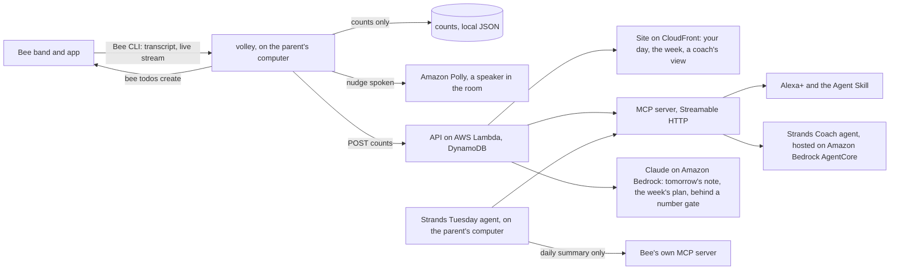

# Volley

**A step counter for conversations with your child.**

The Bee on a parent's wrist already hears the day. Volley counts the back-and-forth exchanges between the parent and the child, keeps the counts, throws the words away on the parent's own computer, and puts one thing to try tomorrow into the Bee as a reminder. During the hour the family usually talks most, it watches the Bee's live stream and sends a nudge the moment that hour goes quiet.

- Demo video (2:56): https://youtu.be/yyk436YlJcY
- Site: https://da78ygi6ol1oi.cloudfront.net
- API and MCP server: https://6gm5fp5kuipgvjgr5zmhghq63u0hmmvd.lambda-url.us-east-1.on.aws (interactive docs at `/v1/docs`, MCP at `/mcp`)
- Open source counter on PyPI: https://pypi.org/project/serve-return/
- For judges: [docs/FOR_JUDGES.md](docs/FOR_JUDGES.md) maps every rule and criterion to the file or link that shows it.

Track: Bee, with Alexa+ through an MCP server and an Agent Skill. Mini challenges: AWS Builder, Open Source.

## What it does

- **Counts turns.** A parent speaks, the child answers inside five seconds, or the other way round: that is one turn. The rule is the one the research uses.
- **Keeps the numbers, never the words.** `volley today` reads the Bee's transcript on the parent's computer, counts, and drops the words. The only files written hold counts.
- **Reads who is talking.** The Bee labels every speaker "Unknown", so Volley reads the roles from the words and the pauses with a small model trained on a public corpus.
- **Places one thing to try tomorrow into the Bee** as a reminder set for the family's best hour.
- **Nudges in the moment.** `volley live --nudge --say` watches the live stream during the usual best hour; if it is twenty minutes in and quiet, one sentence goes into the Bee and a speaker in the room says it, the way an Echo could.
- **Answers out loud.** An MCP server lets Alexa+ answer "How was our talking today?" from the counts alone. Two Strands agents, one hosted on Amazon Bedrock AgentCore, explain a quiet day. Claude on Amazon Bedrock writes the week's plan behind a gate that refuses any number the counts did not hold.
- **Carries coaching between visits.** A read-only share link shows a home visitor the days, the week and the note, and nothing else.

## Why it matters

The number of adult-child conversational turns a child takes part in predicts language and brain outcomes better than the number of words heard [1, 2, 3], and coaching parents to raise that number works [4, 5, 6]. The instrument researchers use to count it is sold to clinics and programmes, not to parents. Volley counts it on a band a parent already wears, for about four cents a family a month (`docs/cost.json`).

## Architecture



Every box is in the code: `apps/ingest` (the command line and the live watcher), `packages/serve-return` (the turn rule and the role model), `apps/server` (API, MCP server, Bedrock), `apps/agent` (the two Strands agents), `apps/agentcore` (the hosted Coach), `apps/web` (the site), `infra` (AWS CDK).

## What is real and what is simulated

- **Real Bee, replayed conversation.** The on-device numbers come from a real recorded parent-child conversation from a public research corpus, voiced by Amazon Polly with an adult and a child voice at its original timing, played to the builder's own Bee. No person was recorded.
- **Real live run.** The nudge ran on the builder's Bee on 2026-10-22, watching the usual hour on the live stream; it fired at 15:20 and the reminder landed in the Bee (`harness/live/nudge-2026-10-22.json`, times and counts only).
- **Simulated family on the site.** The public site shows a generated family, labelled as simulated on every card. A parent's own day appears on their own page after `volley connect`.
- **Simulated Bee for the Tuesday agent's public run.** The agents section on the evidence page says so in its first line.

## Evidence

Every number below is read from a committed result file; the site reads the same files.

| What | Result | File |
|---|---|---|
| Public corpus, human speaker labels | 54 sessions, 26.59 hours, 20,344 reference turns, 0 turns inside the 34 stretches where one person spoke alone | `harness/childes/results.json` |
| Without speaker labels, families the model never saw | median session error 9.6 percent, 49 of 54 sessions within 20 percent, turns per hour correlated with the truth at 0.874 | `harness/blind/results.json` |
| On the Bee, a replayed conversation, 190 seconds | the Bee wrote 124 lines for 125 played; with the true speakers it kept 75 of 75 turns; Volley with no labels found 66 | `harness/beeloop/results.json` |
| A second family at dinner, three voices, 290 seconds | the Bee wrote 152 lines for 166 played, 88 of 96 turns with the true speakers; Volley with no labels found 62 | `harness/beeloop/dinner.json` |
| Two adults, no child, with the child-present check on | 21 false turns to 0, one adult voice 14 to 0, and 66 of 66 real turns kept | `harness/beeloop/controls.json`, `harness/beeloop/with_child.json` |
| The nudge, live | watched 15:00 for 38 minutes, fired at 15:20, placed in the Bee, 0 words kept | `harness/live/nudge-2026-10-22.json` |
| Speaker labels on this Bee account | 30,134 of 30,134 lines labelled Unknown, which is why the roles are read from the words | `harness/bee/unknown_tally.json` |
| Cost | 4.4 cents a family a month, AWS Price List, us-east-1 | `docs/cost.json` |

`python harness/childes/run.py`, `python harness/blind/run.py` and `python harness/beeloop/score.py` reproduce them. [docs/EVIDENCE.md](docs/EVIDENCE.md) says what each number is and how the site is allowed to say it. The product path on the Bee, command by command, is in [docs/BEE_DAY.md](docs/BEE_DAY.md).

## Research

Full list with every PMID and DOI, checked by a test: `docs/citations.json`.

1. Gilkerson J et al. Language Experience in the Second Year of Life and Language Outcomes in Late Childhood. Pediatrics 2018. PMID 30201624.
2. Romeo RR et al. Beyond the 30-Million-Word Gap: Children's Conversational Exposure Is Associated With Language-Related Brain Function. Psychological Science 2018. PMID 29442613.
3. Romeo RR et al. Language Exposure Relates to Structural Neural Connectivity in Childhood. Journal of Neuroscience 2018. PMID 30104336.
4. Romeo RR et al. Neuroplasticity associated with changes in conversational turn-taking following a family-based intervention. Developmental Cognitive Neuroscience 2021. PMID 34052580.
5. Ferjan Ramirez N et al. Parent coaching increases conversational turns and advances infant language development. PNAS 2020. PMID 32015127.
6. Leung CYY et al. Enriching home language environment among families from low-SES backgrounds: A randomized controlled trial of a home visiting curriculum. Early Childhood Research Quarterly 2020. DOI 10.1016/j.ecresq.2018.12.005.
7. Ferjan Ramirez N et al. Comparing Automatic and Manual Measures of Parent-Infant Conversational Turns: A Word of Caution. Child Development 2021. DOI 10.1111/cdev.13495.
8. Gleason JB. CHILDES Gleason corpus. DOI 10.21415/T5101R, used under the TalkBank ground rules; transcripts never leave the builder's machine.

## Run it

No AWS account and no Bee are needed for this.

```
python -m venv .venv && . .venv/bin/activate      # Windows: .venv\Scripts\activate
pip install -e "packages/serve-return[dev]" -e "apps/ingest[dev]" -e "apps/server[dev]" -e "apps/agent[dev]"
cd apps/web && npm ci && npm run dev              # the site, on localhost:3000
```

### If you own a Bee

```
pip install serve-return "volley-bee @ git+https://github.com/usv240/volley#subdirectory=apps/ingest"
volley setup --blind         # the Bee labels every speaker Unknown; Volley reads the roles itself
volley today                 # count since the last run, throw the words away, remind tomorrow
```

Also: `volley setup --daily 20:30` counts every evening on its own; `volley setup --only-with-child yes` sets aside stretches with no child's voice; `volley live --nudge --say` watches the usual hour and nudges; `volley connect` gives your counts a page of your own; `volley share` makes the read-only link for whoever coaches your family. To let your own assistant use the counts: `npx skills add usv240/volley`.

## Tests

```
.venv\Scripts\python.exe -m pytest -q apps/agent/tests apps/ingest/tests apps/server/tests packages/serve-return/tests harness/childes
cd apps/web && npx vitest run
```

158 Python tests and 36 web tests pass. Among them: every Bee CLI argument is pinned; the Agent Skill is pinned to the MCP server's tools; the citations resolve; the public text matches the measured numbers; the note gate refuses numbers the rules did not choose.

## AWS and tools used

| Tool | What it does here | Where |
|---|---|---|
| Bee CLI | transcripts, the live stream, and the reminder written back into the Bee | `apps/ingest/volley_ingest/bee.py` |
| Bee's own MCP server | the Tuesday agent reads the day's summary through it, behind a four-tool allow-list | `apps/agent/volley_agent/tuesday.py` |
| MCP server, spec 2025-11-25, Streamable HTTP | the Alexa+ surface: seven tools, signed sessions | `apps/server/volley_server/mcp.py` |
| Agent Skill | how an assistant uses the seven tools; a test pins it to the server | `skills/volley/SKILL.md` |
| Amazon Bedrock (Claude) | tomorrow's note and the week's plan, behind the number gate | `apps/server/volley_server/bedrock.py`, `plan.py` |
| Strands Agents | the Coach and the Tuesday agent | `apps/agent/volley_agent` |
| Amazon Bedrock AgentCore | hosts the Coach as an invocable endpoint | `apps/agentcore` |
| Amazon Polly | voices the replayed conversation for the on-device test, and says the nudge in the room | `harness/beeloop/make.py`, `apps/ingest/volley_ingest/nudge.py` |
| AWS Lambda, Amazon DynamoDB, Amazon S3, Amazon CloudFront, AWS CDK | the service, the households, the site, one deploy | `infra/bin/app.ts` |

[docs/AWS.md](docs/AWS.md) has the deploy steps and the cost model. [PRODUCT_FEEDBACK.md](PRODUCT_FEEDBACK.md) is the feedback on the Bee and the AWS tools, with the feature requests that would make Volley simpler.

## Privacy

- The parent wears the band. The child wears nothing.
- Words are read on the parent's computer and dropped; counts are the only thing written or posted. A test runs the command and checks that no text is written.
- The parent's own page reads counts with a key that travels in a link fragment, which browsers never send to a server.
- The coach's link is read-only; it can show counts and the note and cannot post, share or delete.
- The Tuesday agent sees the Bee's own daily summary and nothing else; transcript, search, photo and location tools are never offered to it.

[docs/HONESTY.md](docs/HONESTY.md) has the full privacy and consent account.

## Licence

Code: MIT. The role model file (`packages/serve-return/serve_return/models/NOTICE.md`) is trained on the CHILDES Gleason corpus and ships under CC BY-NC-SA 3.0.

Sibling entries in this hackathon, each its own repository: Bellwether (Bee), Earshot and EveryWord (Fire TV), Nightlight (Ring).
